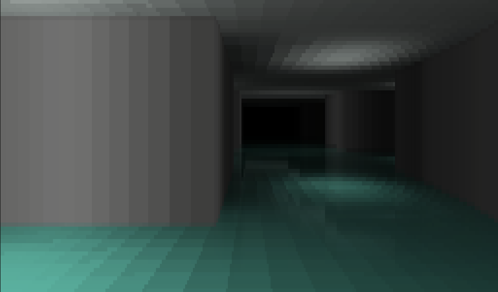
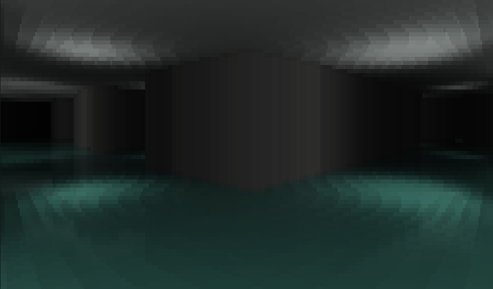
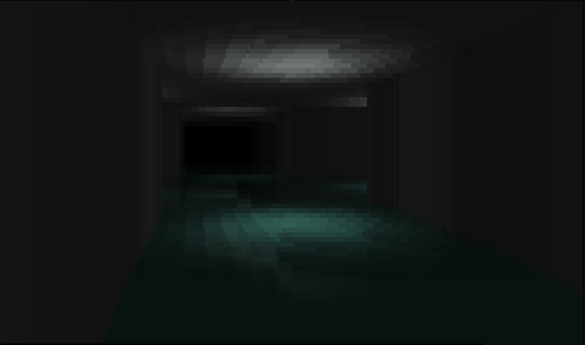

# Sudo-Noclip

Sudo-Noclip is a 3D, backrooms-style horror game that runs entirely in the terminal.



<br>
<p align="center">
<em>Greetings, Traveller.<br><br>
Trust your heart.<br>
Stay in the light.<br>
Do not close your eyes.<br>
Do not let your light go out...<br></em>
</p>
<br>

## Get Started

>Playtime: **~20 minutes**

To play, simply install numba and numpy, download the main `noclip.py` file, and run it:

```zsh
pip install numba numpy
python noclip.py
```

- `WASD` to move
- `O` to turn left
- `P` to turn right
- `1-4` number keys adjust the graphics quality
- `T` toggles the grain VFX.
- `X` quits the game

>_Check out the in game guide for more details_

## Rendering

At its core, this game uses a 2D grid for the map. Raycasting runs every frame across the player's field of view in a horizontal scanline, casting rays to calculate hit distances and collisions. That distance data is then used to draw walls, with a floor and ceiling filling the top and bottom of the screen.

To keep performance high while allowing for precise ray marching, the raycaster uses a downscaled version of the world map alongside the full resolution map to skip marching rays across empty corridors.



## Shading

To render graphics within a terminal, I used Unicode full-block characters (" █ ") as pixels, with ANSI escape codes to add colour. Every frame, the screen buffer is translated into a string, with ANSI escape codes inserted only when the colour along a row changes, as to avoid the ANSI compute cost on non-GPU terminals.

To further mitigate the ANSI cost, I added colour quantisation to restrict the colour shades to a fixed number of steps. This produces fewer colour transitions per row, minimising the frequency of ANSI escape codes.

For lighting, a lightmap is ray-traced during level generation, where each tile on the lightmap corresponds to a tile on the main map. To improve performance, lighting is traced per tile rather than at a finer resolution.

On water-based levels, screen-space reflections (SSR) create the illusion of transparency by using the vertical symmetry of raycasting. For each floor pixel, the `y` screen coordinate is reflected across the bottom of the wall in that column to sample the reflection. Both colour samples are then alpha blended together to render the water effect.



## JIT

To achieve smooth frame rates in a standard Python interpreter, loop heavy functions (raycasting, lightmap generation, rasterisation, and pathfinding) are accelerated using Numba Just In Time (JIT) compilation.

## Licence

This project is licensed under the MIT License
